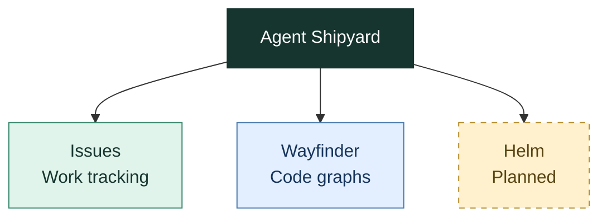

# Agent Shipyard

**Tools for people and AI coding agents to track work and inspect code.**

[Issues](issues/README.md) | [Wayfinder](wayfinder/README.md) | [Helm](helm/README.md)

## Project Map



## Projects

| Project | Purpose | Location |
| --- | --- | --- |
| **Issues** | Track requirements, decisions, issues, and project terms through a CLI, browser view, and MCP server. | [issues/](issues/) |
| **Wayfinder** | Build and query a local code graph with source evidence. Written in Go, with SQLite storage. | [wayfinder/](wayfinder/) |
| **Helm** | Reserved for the Helm project. Implementation has not started in this folder. | [helm/](helm/) |

## Repository Structure

```text
.
|-- issues/                 Issues packages, tools, and documentation
|-- wayfinder/              Wayfinder Go module, npm packages, and documentation
|-- helm/                   Helm project placeholder
|-- design-explorations/    UI prototypes and design experiments
`-- .github/workflows/      Product-specific CI and release workflows
```

Each product owns its build tools, dependencies, and documentation. Run commands
from the product folder. See the project READMEs for setup and development steps.

## Automation

| Workflow | Runs For |
| --- | --- |
| [Issues Publish](.github/workflows/issues-publish.yml) | Issues changes and changes to its workflow. Publishing requires a push to `main`. |
| [Wayfinder CI](.github/workflows/wayfinder-ci.yml) | Wayfinder changes and changes to its CI or release workflows. |
| [Wayfinder Release](.github/workflows/wayfinder-release.yml) | Tags that match `v*`. |