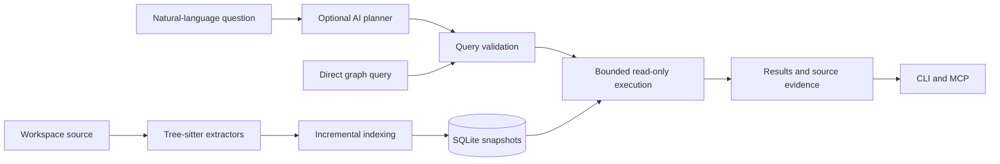

# Agent Wayfinder

**A local code graph for AI agents, built in Go and stored in SQLite.**

Agent Wayfinder extracts code structure and relationships from a workspace.
It lets an agent find relevant code, trace relationships, and return evidence
with source locations. The graph supports code investigation. It does not
replace source inspection, language servers, tests, or Git.

The core index and direct queries run locally without an AI provider.
Optional AI providers translate natural-language questions into bounded,
read-only graph queries.

[Quick Start](#quick-start) | [Design](#design) | [Agent Integration](#agent-integration) | [Development](#development)

## The Problem

Text search finds names and strings. A language server finds exact symbols.
Neither gives an agent a persistent workspace graph that it can query for
relationships between files, declarations, and calls.

Agent Wayfinder adds that graph as a separate source of evidence. An agent can
retrieve a small result set instead of loading a complete graph export or
reading unrelated files. Each result identifies the indexed snapshot, so the
agent can check its evidence against current source.

## What It Does

| Capability | Implementation |
| --- | --- |
| Source extraction | Tree-sitter extractors for Go, JavaScript, and TypeScript |
| Local storage | SQLite, with FTS5 lexical search and optional sqlite-vec embeddings |
| Graph updates | Initial indexing and incremental replacement of changed or deleted source facts |
| Direct queries | A constrained graph language with bounded traversal and required result limits |
| Natural-language questions | Optional Ollama, Copilot, or Claude query planning |
| Evidence | Source locations, graph version, publication time, warnings, and execution limits |
| Agent access | CLI, bundled agent skill, and a read-only MCP server |
| Catalog retrieval | Capability synopses, lexical retrieval, and optional local embeddings |

## Quick Start

Install the CLI from npm. Node.js 18 or later is required for installation.

```bash
npm install --global agent-wayfinder
awf --help
```

The installer downloads a checksum-verified native binary. Published targets
are Windows x64, Linux x64, and macOS arm64.
The scoped package, `@arcmantle/agent-wayfinder`, is also available.
Use `agent-wayfinder` or its short alias, `awf`. Both run the same CLI.

### Index And Query A Project

Run these commands from a Go, JavaScript, or TypeScript project:

```bash
awf index --catalog-background=false .
awf query --query "MATCH (node) RETURN node LIMIT 10" --format json
```

The first command builds the graph without starting background catalog work.
The default database is `.agent-wayfinder/graph.db` in the workspace.
The second command returns up to ten nodes from a published snapshot.
Neither command needs an AI provider.

For a short demonstration, index this repository and find its `main` declarations:

```bash
awf query --query "MATCH (node {name: 'main'}) RETURN node LIMIT 10" --format json
```

Use a returned node ID to inspect a specific result:

```bash
awf inspect . <node-id> --format json
```

When both endpoints are known, trace a directed relationship path:

```bash
awf path . <source-node-id> <target-node-id> --format json
```

Replace the placeholders with node IDs from your results. A missing path does
not prove that two parts of the application are unrelated. The graph contains
only relationships that the extractors can resolve.

### Ask A Question

Natural-language questions require a configured provider. For example, use
Ollama with a locally available model:

```bash
ollama pull qwen3:8b
```

Add this configuration to `.agent-wayfinder/config.json` in the project:

```json
{
  "$schema": "https://raw.githubusercontent.com/arcmantle/agent-wayfinder/main/schemas/config.schema.json",
  "planning": {
    "provider": "ollama",
    "ollama": {
      "model": "qwen3:8b",
      "timeout": "30s"
    }
  }
}
```

Start Ollama before you run the question:

```bash
awf ask "What is the application entrypoint?" --path . --format json
```

The result includes the selected query, source evidence, confidence, warnings,
and limits. Confidence comes from candidate agreement and execution evidence,
not from a model's own confidence statement.
See [Configuration](docs/configuration.md) for other providers and spending limits.

## Design



### Database-First Storage

SQLite is the query store. Graph JSON is an explicit export, not a document
that each query must load and scan. Graph snapshots let a query use one
published version while updates produce the next version.

Storage contracts are separate from the SQLite adapter. The current
implementation uses SQLite; PostgreSQL is not a shipped backend.

### Isolated Language Extractors

Each language package owns its parser integration and local-fact extraction.
A registry combines the packages through shared contracts. This keeps
language-specific parsing separate from indexing, storage, and query execution.

### AI Planning, Controlled Execution

The planner proposes up to three query candidates. Agent Wayfinder parses and
validates them against the snapshot vocabulary before it executes parameterized
SQLite queries. The model does not get arbitrary SQL access.

Direct queries do not use AI. The graph language supports `MATCH`, lexical and
vector `SEARCH`, directed relations, bounded paths, predicates, `RETURN`,
`ORDER BY`, and required `LIMIT`. It is not full Cypher. Writes, arbitrary SQL,
unbounded paths, aggregation, subqueries, and procedure calls are rejected.

For `ask` and `query`, the default resource caps are two traversal levels and
100 nodes. Queries report truncation. `ORDER BY` sorts the bounded candidate
set, not an unlimited scan. Provider failure or invalid candidates produce an
error without an automatic cross-provider fallback.

### Explicit Resource And Privacy Limits

Extraction queues and storage batches have limits. Lexical snapshot writes
also have row and byte limits. The production database limit is 4 GiB.
These limits reduce retained work; they do not guarantee that every workspace
fits within the database limit.

AI planning receives the question, grammar, vocabulary, retrieval capabilities,
and limits without source code by default. Optional AI catalog synopses can
send bounded declaration source to a provider. Enable those features only
when that code-sharing boundary is acceptable.

## Agent Integration

### Bundled Skill

```bash
awf install
```

This installs the bundled skill at user level. Use `awf install --project`
for a project-level installation. The skill directs an agent to query the
graph, check source evidence, and validate code changes.

### MCP Server

```bash
awf mcp
```

The read-only server uses standard input and output. It provides `ask`,
`query`, `path`, `inspect`, and `export`. Results use the same JSON contracts
as the CLI. Indexing remains a CLI operation.

The [VS Code MCP provider](npm/vscode-mcp-provider) registers the server as
`Agent Wayfinder`. It uses the first workspace folder by default. Configure
`agentWayfinder.mcp.command` and `agentWayfinder.mcp.args` to change the command.

Agent Wayfinder also complements `agent-issues`: the tracker records work,
dependencies, and decisions; Wayfinder records code structure and relationships.

## Development

Source builds require the Go version in [go.mod](go.mod), a C compiler, and
`CGO_ENABLED=1` for Tree-sitter and SQLite. Use the repository Makefile:

```bash
make build
make test
make lint
make run ARGS='index --catalog-background=false .'
make run ARGS='query --query "MATCH (node) RETURN node LIMIT 10" --format json'
```

`make run` reuses the local binary until source changes require a rebuild.
`make check` builds the CLI, runs acceptance checks, and runs Go vet.

Tests cover extraction, storage conformance, incremental updates, query
execution, indexer lifecycle, CLI contracts, and MCP behavior. Graphify
comparison fixtures check selected extraction behavior against the reference.
The private ClientFlex corpus test is opt-in and uses a temporary database.

## Limits And Tradeoffs

- The graph is an index, not the source of truth. Refresh it after source changes
  and inspect current source before you rely on a result.
- Static extraction cannot prove every runtime relationship or call path.
- Natural-language questions need an AI provider. Indexing and direct graph
  queries do not.
- Embeddings and AI catalog synopses are optional and disabled by default.
- The query language deliberately trades expressiveness for bounded execution.
- Benchmark results depend on the corpus and runtime. One constrained run is
  not a general performance claim.

## Further Reading

- [Configuration](docs/configuration.md): source selection, catalog settings,
  providers, budgets, and indexer commands.
- [Benchmarks](docs/benchmarks.md): diagnostics, constrained runs, and retained results.
- [Configuration schema](schemas/config.schema.json): supported settings.
- [Bundled skill](cmd/agent-wayfinder/skill/skill_assets/SKILL.md): agent workflow.
- [Acceptance tests](acceptance): release and external-corpus checks.

Graphify was the original behavioral reference for the code graph. This project
uses a Go-native, database-first implementation rather than a file-by-file port.